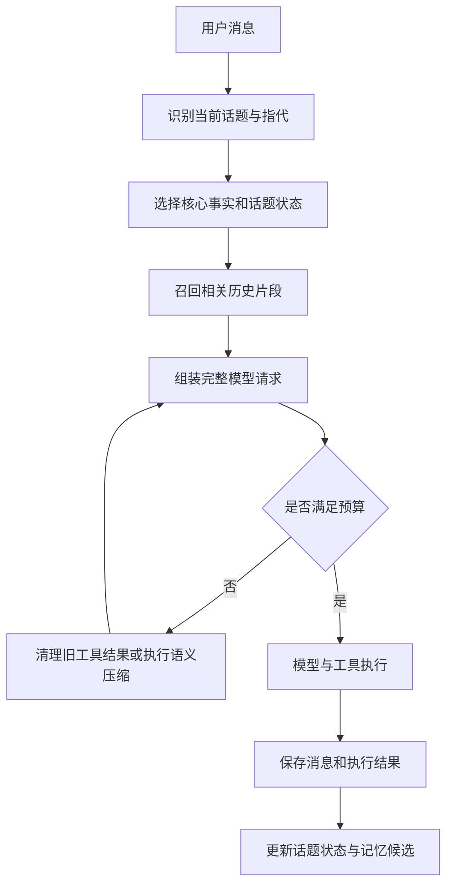

# Friday 单主会话上下文优化方案

> 编写日期：2026-10-21  
> 状态：设计方案，尚未实施  
> 适用范围：Friday 主会话、vortexagent 上下文引擎，以及记忆与业务状态的衔接

## 1. 目标与结论

Friday 的网页、终端、钉钉、飞书等聊天入口共用一个主会话，用户会在同一条对话中交错处理不同事情。后台任务与目标执行另有隔离会话。

这个使用方式要求系统同时解决两类问题：模型请求不能超过上下文窗口；多次压缩、切换话题和重启之后，仍能找回用户约定、未完成事项和已经执行的结果。

建议保留现有“原文归档＋交接摘要＋最近消息＋按需检索”的基础，按以下顺序演进：

1. 修复压缩并发、摘要格式、选择顺序与持久化问题，先确保不丢信息。
2. 实现完整请求预算、工具结果清理和全文检索，让上下文容量与历史恢复可控。
3. 在一个主会话内部维护多个话题的工作状态，解决长期使用中的话题混杂与状态遗忘。
4. 为长期记忆增加来源、修正关系和生命周期，通过长会话评测持续调优。

用户仍然面对一个主会话。话题划分、状态保存与相关内容召回由系统内部完成。

## 2. 现状与审查依据

### 2.1 当前实现

| 模块 | 位置 | 当前职责 |
| --- | --- | --- |
| 主会话与请求串行化 | `internal/agent/pool.go`、`brain.go` | 会话恢复、按 key 加锁、Ask 结束后保存 |
| 上下文接入 | `internal/agent/context.go` | 构建引擎、手动压缩、重置归档、上下文快照 |
| 模型与工具接线 | `internal/agent/robot.go` | 构建 Agent、注册历史检索工具、注入工具规则 |
| 长期记忆 | `internal/memory/memory.go` | 按主题保存 wiki 页面 |
| 通用压缩与归档 | vortexagent `ctxengine/` | 分块、生成摘要、归档、摘要合并与历史检索 |
| 请求组装 | vortexagent `agent/ask.go` | 组装消息、系统提示词、工具声明并请求模型 |

本次评估基于 Friday 实际依赖版本：

```text
github.com/capyflow/vortexagent v0.0.0-20261014084044-66f2a578013f
```

审查时本地 vortexagent 的 `ctxengine/engine.go`、`ctxengine/archiver.go` 与该依赖版本内容一致。后续开发应重新核对依赖和源码版本。

### 2.2 对照工具的可借鉴机制

| 来源 | 已核对机制 | Friday 的采用方式 |
| --- | --- | --- |
| 本机 ZCode 3.16.2 | 旧工具结果局部清理、输出预算预留、压缩失败熔断、压缩边界指标 | 分两级压缩，记录触发原因和压缩收益 |
| OpenCode 官方配置文档 | `auto`、`prune`、`reserved` 分别配置自动压缩、旧工具输出清理和预留预算 | 分离策略开关，允许逐步启用 |
| Anthropic 上下文工程实践 | 保留关键决定与未解决事项，以持久笔记保存跨窗口工作状态 | 持久化话题工作状态，按需恢复 |

ZCode 结论来自本机安装包 `zcode.cjs` 中可直接读取的函数体，包括 `maybeLocalMicrocompactMessages`、`getAutoCompactThreshold` 等。整包静态分析遇到内存上限，未取得完整调用图，不能据此断言每条运行路径都会启用这些机制。OpenCode 文档核对时，`prune` 是独立选项，默认关闭。

参考资料：

- [OpenCode：Compaction 配置](https://opencode.ai/docs/config/#compaction)
- [Anthropic：Effective context engineering for AI agents](https://www.anthropic.com/engineering/effective-context-engineering-for-ai-agents)

## 3. 优先修复的问题

以下“已复现”表示在依赖版本的临时副本中，用确定性测试观察到了现有缺陷；不表示已经修复。

| 编号 | 优先级 | 问题与证据 | 目标行为 |
| --- | --- | --- | --- |
| C01 | P1 | **已复现**：`archiveSession` 等待摘要后，用旧快照的 `keepMsgs` 整体 `ResetTo`，期间追加的消息可同时从活跃历史和归档中消失 | 只移除已归档的快照前缀，保留之后追加的消息 |
| C02 | P1 | **已复现**：提示词要求扁平 JSON，`parseHandoff` 却读取嵌套 `handoff`；遵循提示词会在三次调用后降级 | 提示词与解析器共用明确 schema，正常路径一次调用完成 |
| C03 | P1 | **已复现**：摘要按创建时间升序装填，预算不足时旧约定保留、最新修正被挤出 | 最新修正、当前话题与未完成事项优先 |
| C04 | P1 | **静态确认**：`HardLimitTokens()` 没有实际调用；系统提示词和工具声明在 `Build` 后加入，未统一预留回复空间 | 完整请求在每次模型调用前经过预算校验 |
| C05 | P1 | **静态确认**：Ask 返回时保存会话，后台压缩稍后修改历史没有对应保存回调 | 压缩提交与持久化具备可恢复的一致性 |
| C06 | P2 | **已复现**：检索只搜索摘要和块首条用户消息，正文独有的编号可能零命中 | 原文正文、精确实体与摘要均可检索 |
| C07 | P2 | **静态确认**：global 摘要不参与后续合并；旧 chunk 先标记 merged，再保存新 global | 摘要层级有界，替换关系原子发布 |
| C08 | P2 | **静态确认**：候选事实直接写普通 wiki 页，忽略会话和 chunk 来源，缺少冲突与过期管理 | 候选事实具有来源、状态和修正关系 |

相关源码入口：vortexagent `ctxengine/engine.go`、`archiver.go`、`retriever.go`、`store_fs.go`、`agent/ask.go`；Friday `internal/agent/context.go`、`brain.go`。

### 3.1 容量不足时的额外边界

当前普通压缩在块数不超过 `KeepRecentBlocks` 时直接返回，最新块又无条件保留。单轮产生大型工具结果时，即使触发阈值也可能无法缩减。

因此，块数只能作为辅助约束。预算必须能够约束当前轮的工具结果，且不能拆散工具调用与结果的配对关系。不可重新读取的执行结果，应先可靠保存原文与执行状态，再缩减其模型可见表示。

## 4. 目标上下文结构

将“保存了哪些数据”和“本轮发给模型哪些数据”分开管理。原始记录完整保存，本轮只选择与当前请求有关、预算允许的内容。



| 层次 | 保存内容 | 注入规则 |
| --- | --- | --- |
| 核心事实 | 已确认偏好、长期约定、重要修正 | 小规模核心信息常驻，其余按需召回 |
| 话题工作状态 | 目标、约束、决定、已执行结果、未完成项、取消状态、下一步 | 当前话题优先，其他话题只带有限索引 |
| 事件摘要 | 某段对话发生的事情、实体、时间与原文引用 | 按相关性、时间和重要性选择 |
| 最近消息 | 最近问答、当前轮工具调用与结果 | 保留当前请求必需信息，工具大结果单独治理 |
| 原始记录 | 完整对话、工具输入输出、附件引用 | 全文定位后按段展开 |

长期事实、话题状态、事件摘要分别承担不同职责。避免把所有内容持续合并成一份不断重写的全局摘要。

## 5. 压缩可靠性与持久化

### 5.1 消息身份与会话版本

为消息或持久化消息信封提供稳定 ID、单调序号；为会话提供 generation。重置会话时递增 generation，避免同一个会话 ID 下的旧压缩作业重新发布内容。

压缩作业至少记录：

```text
job_id
session_id
session_generation
engine_generation
snapshot_revision
archive_through_message_id
source_message_ids / source_digest
summary_schema_version
status: prepared | committed | failed
```

这些是拟议内部字段，尚未实现。revision 用于检测修改，generation 用于识别重置或引擎更换；不能只凭消息条数判断快照是否仍有效。

### 5.2 提交协议

1. 在会话协调锁内截取可压缩的完整前缀，记录消息范围、摘要和版本信息。
2. 锁外持久化原文并计算摘要。原文使用内容指纹去重，摘要结果暂不进入可见摘要区。
3. 重新取得同一会话协调锁，检查 generation、源前缀和引擎版本。
4. 仅发生追加时，移除快照中已经归档的前缀，保留完整后缀；发生回滚、重置或前缀修改时，放弃或重新计算。
5. 原子提交活跃历史边界与可见摘要引用，然后刷新内存缓存。

后台压缩、手动压缩、重置、Ask 的历史修改必须遵守同一协调规则。当前基于数组长度的错误回滚也需要同步调整为按本轮消息范围回滚，防止压缩后旧长度失效。

现有 JSON 会话存储与文件归档不具备跨文件事务。第一阶段可先采用**安全边界同步提交**：后台只计算，Ask 开始或结束时在会话锁内应用结果并保存。失败时保留完整活跃历史，暂不发布摘要引用。若需要空闲期间自动提交，再增加提交日志与启动恢复流程。

崩溃恢复必须能够识别“原文和摘要已准备，但活跃边界尚未推进”的情况，幂等完成或放弃提交；不得重复注入同一段原文与摘要。

### 5.3 生命周期

- 会话重置：使旧 generation 作业失效，旧作业不得重建已删除的可见上下文。
- 模型或配置变更：停止旧引擎接收作业，取消或等待在途任务，再按版本校验提交。
- 摘要合并：先写新摘要，再发布替代关系；发布失败时旧摘要仍可用。
- 保存失败：保留可恢复记录并报告失败，不能显示压缩成功后静默丢失数据。

## 6. 完整请求预算与两级压缩

### 6.1 统一预算口径

每次模型调用前，按最终请求表示估算：

```text
预计输入 = 系统指令 + 工具 schema + 核心事实 + 话题状态
         + 事件摘要 + 最近消息 + 检索片段 + 多模态估算 + 协议开销

允许输入 = 模型窗口 - 回复预留 - 安全余量
```

有独立输入上限的 provider，还应取其约束与上述允许输入的较小值。回复预留依据本轮模型配置确定，不能默认无限或使用不匹配的固定值。

token 计数优先使用可用的 tokenizer 或 provider 计数能力；无法精确计数时使用估算并结合真实 usage 校准。工具 schema 的开销应纳入估算，避免继续通过消息估算系数间接补偿。按模型、provider 和请求表示区分校准状态。

软阈值用于提前治理，硬上限用于发送前阻断超预算请求。两者采用完整请求口径；保留现有活跃历史指标作为独立统计项。

### 6.2 一级：工具结果清理

先压缩重复、过时、可重新读取的工具结果，保留简短结果、来源和原文定位信息。建议规则：

- 保留当前调用链所需结果、最近若干组结果和未解决错误。
- 写入、发送、安排任务等有副作用操作，保留是否成功、目标和业务 ID，防止重复执行。
- 清理只改变模型可见表示，原始结果可靠保存后才能缩减。
- 保留调用与结果配对；可使用占位结果，不能留下孤立的工具消息。
- 超大结果优先分页和按需读取；占位必须能定位回完整原文。
- 空闲时间可作为重新选择上下文的信号，不能单独授权不可恢复的数据删除。

### 6.3 二级：语义压缩

一级清理仍不足时，对安全前缀生成结构化摘要。摘要输入按预算分批，避免摘要请求本身超窗；输出预算根据话题数与关键状态量分配。

新摘要 schema 应版本化，至少包含：

```json
{
  "schema_version": 2,
  "topics": [
    {
      "topic_id": "topic-trip-001",
      "goal": "制定周末出行计划",
      "constraints": ["用户要求不安排早班交通"],
      "decisions": [],
      "corrections": [],
      "completed_actions": [],
      "pending": ["确定住宿"],
      "status": "active",
      "source_message_ids": ["msg-001"]
    }
  ],
  "candidate_facts": []
}
```

示例仅定义设计方向。第一阶段应先修复现有 schema 契约，再引入此版本，避免同时扩大变更面。解析器必须校验有效内容、来源和截断情况；无效摘要不能推进活跃边界。

连续失败达到上限后停止重复后台重试，记录熔断原因。硬预算仍然生效：可继续减少可恢复的内容，必要时返回明确的容量错误；不能在失败后直接发送超窗请求。

## 7. 单主会话的话题工作状态

### 7.1 数据结构

话题状态是对某件事情的工作记录，建议独立于会话消息持久化：

| 字段 | 含义 |
| --- | --- |
| `id`、`title`、`aliases` | 稳定身份、显示名称与检索别名 |
| `status` | active / waiting / completed / cancelled |
| `goal`、`constraints` | 当前目标与用户明确约束 |
| `decisions`、`corrections` | 确认的决定及其修正关系 |
| `actions` | 已执行动作、结果、业务 ID 与来源 |
| `pending`、`next_step` | 未完成事项和可执行的下一步 |
| `entity_refs`、`business_refs` | 人物、地点、文件、todo/task/goal 等引用 |
| `source_refs`、`updated_at`、`revision` | 来源、更新时间与并发版本 |

已完成或取消的话题退出默认工作区，保留检索能力。再次讨论历史话题不等于自动恢复已取消动作。

### 7.2 话题选择与恢复

优先使用明确话题名、业务 ID、实体和当前活跃话题判断归属。用户说“继续刚才那个行程”时，召回行程状态、相关约定和最近关键原文；插入的天气查询不应覆盖行程目标。

一次消息可以关联多个话题。系统对指代不清且候选接近的情况进行简短澄清，避免强行归属。普通寒暄和一次性查询不必都形成长期话题记录。

每轮默认注入当前话题状态；其他未完成话题按相关性提供有限索引，不能把所有未完成话题全文常驻。来源于摘要的推断与用户明确要求应区分，推断不能扩大执行授权。

### 7.3 与业务状态衔接

todo、task、goal 等现有业务存储是对应执行状态的依据。话题状态保存引用和必要解释，使用前按需刷新；摘要中的旧状态不得覆盖业务存储中的最新状态。

临时口头事务可以维护轻量话题记录，不强制创建正式待办。用户修正约束或取消某事时，在本轮成功保存后更新状态，不能等到下一次压缩才生效。

## 8. 历史检索与长期记忆

### 8.1 全文检索

先实现中文可用的原文全文检索与编号、路径等实体的精确匹配，再按需要增加语义召回。索引覆盖用户、助手和工具正文，并保留会话、话题、消息、时间及来源。

检索结果返回命中片段与稳定引用，对同一原文的块命中和摘要命中去重。`expand_chunk` 增加分页或命中定位，超大消息支持局部展开，避免总是从头截断。

索引是可重建的派生数据。历史归档可增量回填，记录索引版本与进度；回填失败时保留原文并显示当前覆盖范围，不能把未索引解释成不存在。

自动召回应受单轮预算约束，优先选择当前话题、明确实体和最近修正；模型仍可主动调用检索工具。恢复的历史必须标注来源与时间，作为历史数据处理，不能提升为新的系统指令。

### 8.2 记忆治理

在现有 wiki 页面基础上，为事实补充来源消息或 chunk、来源会话、更新时间、状态及替代关系。来源可以存于 frontmatter 或独立元数据文件，具体格式在实施时确定。

事实状态至少区分 candidate、confirmed、superseded、expired。用户明确要求记住的内容可进入确认流程；后台任务推断只进入候选区。用户修正时发布替代关系，旧版本不再作为当前事实注入。

候选事实按主题与实体合并，不再用正文前 24 字作为主要去重依据。页面整体替换时增加 revision 校验，防止并行更新覆盖。过期信息依照事实类型处理，不能统一凭时间删除所有偏好。

删除和忘记需要明确覆盖范围：会话上下文、长期记忆、话题状态、归档与索引分别处理，界面说明实际效果，避免用户删除一处后又被另一处自动召回。

## 9. 可观测性与配置

上下文面板分别显示“活跃历史占用”和“完整请求预计占用”。新增压缩事件记录触发原因、来源范围、前后 token、保留消息数、耗时、降级原因、失败次数和提交结果。

需要重点监控：完整请求超窗率、压缩成功率与收益、降级率、压缩后立即再次触发比例、历史检索零命中率、重复执行与状态冲突。检索零命中率只能作为诊断信号，不能单独代表检索质量。

拟议配置分组：

| 分组 | 可配置项 | 发布策略 |
| --- | --- | --- |
| 请求预算 | 输出预留、安全余量、软阈值 | 先影子计算，再启用硬校验 |
| 工具结果清理 | 开关、保留组数、清理范围 | 独立开关，逐步启用 |
| 摘要 | schema 版本、输入分批、输出预算、失败上限 | 兼容旧摘要读取 |
| 检索 | 自动召回开关、数量、token 上限 | 全文索引完成后启用 |
| 话题状态 | 开关、注入预算、其他话题索引上限 | 先记录，再参与组装 |
| 候选记忆 | 提取开关、确认与合并规则 | 先修复来源，再扩大自动提取 |

以上配置尚未实现，不应直接写入现有配置文件。默认值应通过实际模型和长会话轨迹确定。

## 10. 实施阶段与仓库边界

| 阶段 | vortexagent | Friday | 完成条件 |
| --- | --- | --- | --- |
| A：可靠性 | 安全前缀提交、schema 契约、摘要选择、合并发布、回滚范围 | 协调锁接入、提交保存、重置与重建生命周期、升级依赖 | 并发、保存失败和重启恢复测试通过 |
| B：预算与检索 | 完整请求预算、两级压缩、全文索引与分页展开 | 配置、指标、面板和错误呈现 | 大结果和连续工具循环不绕过硬预算，正文实体可检索 |
| C：话题与记忆 | 提供来源和选择扩展点 | 话题状态仓库、业务状态引用、记忆候选与修正管理 | 交错话题、取消和纠正场景正确 |
| D：迁移与调优 | 摘要层级与性能优化 | 历史索引回填、灰度、评测和可视化诊断 | 连续多次压缩与长时间恢复达到质量门槛 |

通用消息与预算能力放在 vortexagent；Friday 的生活管家语义、话题状态与业务联动放在 Friday。通过正式依赖版本接入，避免直接修改 Go 模块缓存。

旧数据迁移采用增量方式：保留原始归档，旧摘要按旧版本读取，新摘要写入新 schema。历史话题状态只按需重建，不在启动时全量调用模型。原文中不存在的细节不得通过重建补造。

新策略应支持关闭。回退后仍需读取已提交的摘要和活跃边界，不能恢复已被取代的旧历史或退回已知不安全的提交方式。

## 11. 验收与评测

### 11.1 必须通过的正确性场景

| 场景 | 预期结果 |
| --- | --- |
| 压缩过程中追加下一轮消息 | 新消息完整保留，工具配对合法 |
| 压缩过程中重置会话或更换引擎 | 旧作业不发布，不带回旧摘要 |
| 摘要写入、会话保存任一步骤失败 | 原有有效上下文仍可恢复，无静默丢失 |
| 在提交边界注入崩溃后重启 | 原文与摘要不重复注入，无消息缺口 |
| 模型严格输出提示词指定 JSON | 正常路径一次调用完成，字段可解析 |
| 摘要预算只能容纳部分内容 | 最新纠正和当前工作状态按规则保留 |
| 单轮产生超大工具结果 | 先归档和缩减表示，仍满足完整请求预算 |
| 关键编号只存在归档正文 | 能命中并展开对应段落 |
| 行程、天气、账单交错后继续行程 | 恢复行程目标与约束，不误用账单状态 |
| 用户取消、完成或修正一件事 | 后续压缩不复活旧任务，不重复已执行动作 |
| 连续进行多次压缩与摘要合并 | 关键约束有来源，摘要总量有界 |
| 删除记忆或归档后重新检索 | 按声明范围删除派生索引，不出现残留召回 |

### 11.2 质量与成本评测

建立固定长会话样本，包含多话题交错、长期偏好修正、短句指代、未完成事项、执行副作用和大型工具输出。对比优化前后：

- 关键事实与约束保留率、话题恢复准确率、精确实体检索命中率。
- 取消事项复活次数、重复执行次数、消息丢失或覆盖次数。
- 每轮输入 token、累计摘要成本、压缩等待时间和检索延迟。

消息丢失、取消事项复活和重复执行在确定性回归样本中必须为零。质量指标在固定样本上不得低于基线，再评估 token 和延迟收益；不能用压缩率替代记忆质量。

### 11.3 已有验证与待补验证

前期评估运行 Friday `go test ./internal/agent ./internal/memory`，80 项通过；在依赖版本临时副本中分别复现了 C01、C02、C03、C06。

这些结果说明现有常规测试没有覆盖部分长会话缺陷。实施时应把复现转为期望正确行为的正式回归测试，并补充提交故障、崩溃恢复与多次压缩质量评测。本方案本身未修改运行代码，也未执行数据迁移。
